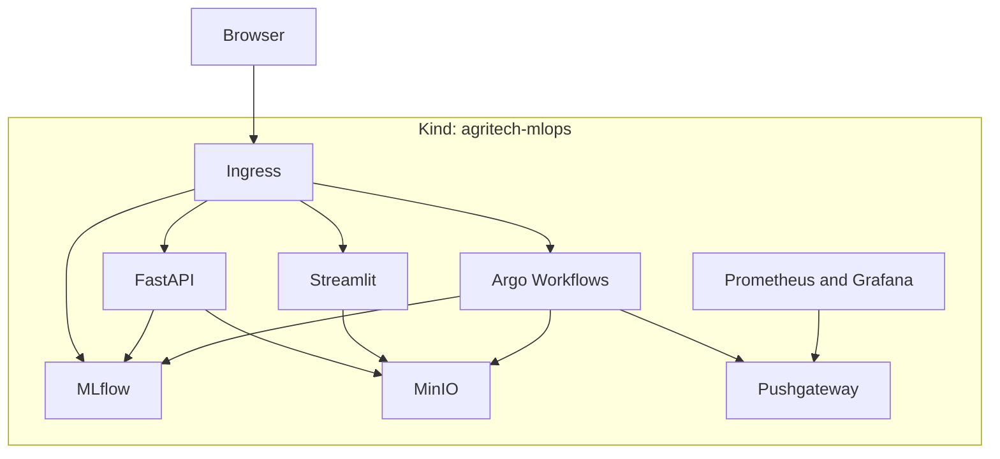

# Iris MLOps ラボ

> 以前作った作業履歴のみのリポジトリをLLMでまとめ直しました。 


Kind 上で Iris 分類モデルを **学習 → 登録 → 推論 → 可視化 → 監視** まで通す、ローカル向けの MLOps 構成です。

Kubernetes、MLflow、MinIO、Argo Workflows、FastAPI、Streamlit、Prometheus / Grafana を一つのクラスターに置いてあります。農業センサーや生育ステージの監視は含みません。

## 構成



- 前処理・学習・評価は Argo の DAG（`pipelines/dag/`）。評価が Model Registry の `argo-dag-demo` に登録する。
- 追跡 DB は MLflow の sqlite、成果物は MinIO の `s3://mlflow-artifacts`。
- FastAPI が `/predict` と `/predict/{version}` を提供する。既定 URI は `models:/argo-dag-demo/15`。
- Streamlit が特徴量を入力して推論する。
- 評価ステップの accuracy / loss は Pushgateway に送る。

ローカル用の MinIO 認証情報は `minio` / `minio123` です。共有クラスターでは使わないでください。

## ディレクトリ

```
.
├── kind-config.yaml          # Ingress 用ポートとローカルレジストリの mirror
├── api/                      # FastAPI
├── streamlit/                # Streamlit
├── pipelines/dag/            # 前処理、学習、評価、DAG
├── train.py                  # 単発の学習スクリプト
├── monitoring/               # ServiceMonitor、exporter、Grafana JSON
├── charts/minio/             # MINIO_BROWSER 重複を避けた MinIO chart
├── docker/mlflow/            # boto3 入り MLflow イメージ
├── docker/minio-pf/          # ホストから MinIO へ port-forward するコンテナ
├── scripts/                  # イメージビルド、Argo 用 TLS
└── doc/                      # 手順
```

マニフェストの多くはリポジトリ直下にあります（`mlflow-deploy.yaml`、`argo-ingress.yaml`、`minio-values.yaml` など）。

## 前提

- Docker
- [Kind](https://kind.sigs.k8s.io/)
- kubectl
- [Helm](https://helm.sh/docs/intro/install/)
- ローカルレジストリ用にホストの 5001 番が空いていること（MLflow が 5000 を使うため）

## 手順

クラスター名は `agritech-mlops` です。次の順で進めてください。

1. [Kind と Ingress](doc/01-cluster.md)
2. [MinIO と MLflow](doc/02-mlflow.md)
3. [Argo Workflows](doc/03-argo.md)
4. [FastAPI](doc/04-fastapi.md)
5. [Streamlit](doc/05-streamlit.md)
6. [Prometheus / Grafana](doc/06-monitoring.md)

構築中に踏んだ失敗と対処は [つまずき](doc/pitfalls.md) にまとめてあります。Argo UI の認証をローカルだけで外す手順は [doc/local-auth.md](doc/local-auth.md) です。

## 未実装

- 学習後に推論 API のモデルを自動で切り替えること
- 温度・湿度・土壌水分や生育ステージのダッシュボード
- MLflow の追跡 DB を PostgreSQL に移すこと

sqlite バックエンドでは `mlflow.pyfunc.load_model` が失敗することがあり、FastAPI はフォールバックとバージョン固定で動いています。詳細は [doc/pitfalls.md](doc/pitfalls.md) を見てください。

## ライセンス

[MIT](LICENSE)
