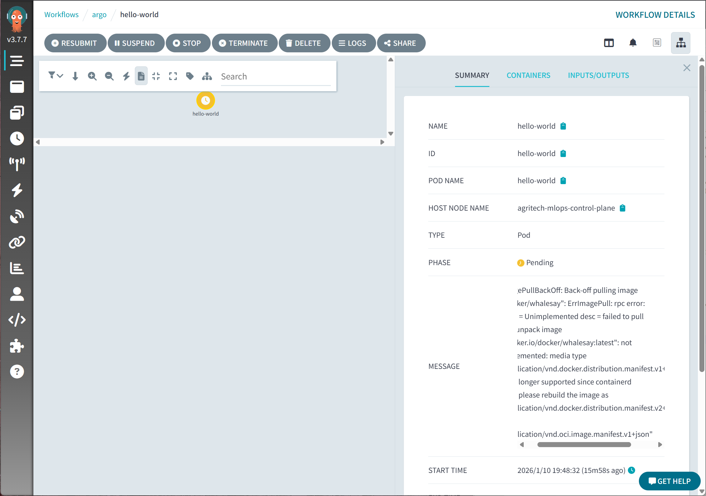
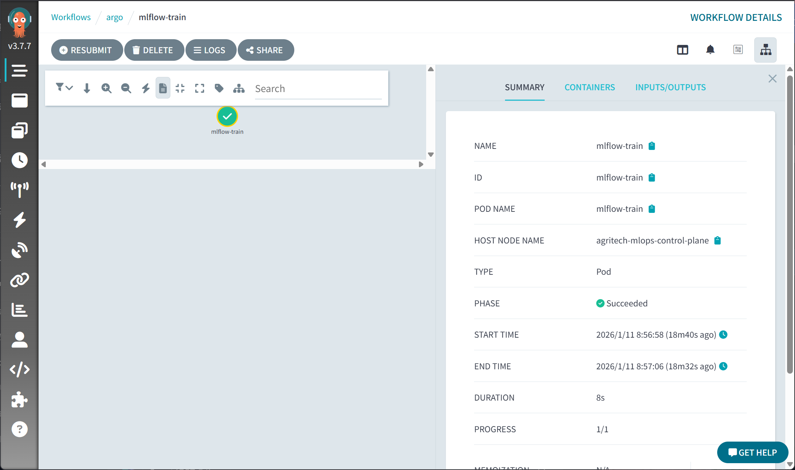
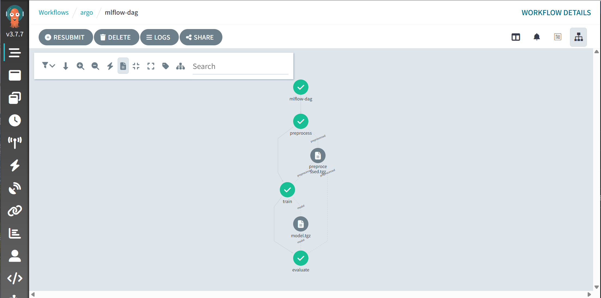
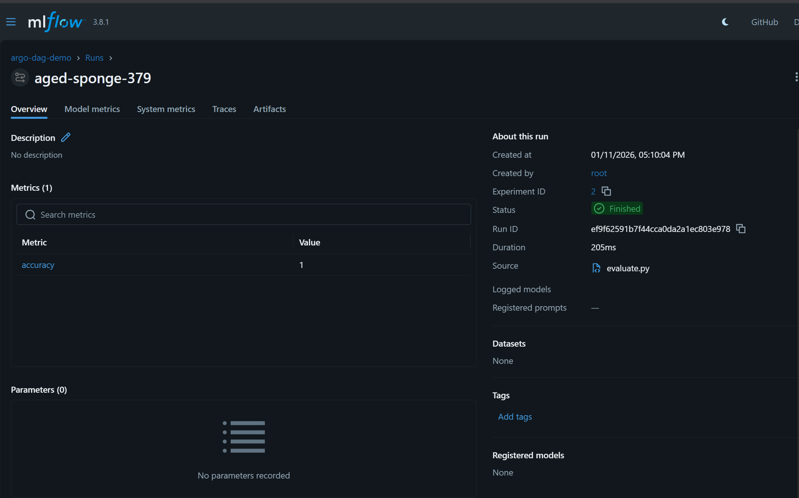

# Argo Workflows

Argo で Hello World、単発の Iris 学習、前処理 → 学習 → 評価の DAG を動かします。DAG の評価ステップが MLflow Model Registry の `argo-dag-demo` にモデルを登録します。

## 前提

- [MinIO と MLflow](02-mlflow.md) が済んでいること
- `argo` 名前空間の Secret `minio-cred` があること

## 手順

### インストールと Ingress

```bash
kubectl create namespace argo --dry-run=client -o yaml | kubectl apply -f -
kubectl apply -n argo -f https://github.com/argoproj/argo-workflows/releases/latest/download/install.yaml
kubectl -n argo rollout status deployment/argo-server
kubectl -n argo rollout status deployment/workflow-controller
```

UI は HTTPS です。証明書を Secret `argo-tls` に入れ、Ingress を適用します。

```bash
./scripts/create-argo-secret.sh
kubectl apply -f argo-ingress.yaml
```

ローカルだけでクライアント認証を外す手順は [local-auth.md](local-auth.md) です。公開や共有のクラスターでは実行しないでください。

成果物ストアと controller のメトリクスは [argo-artifact-config.yaml](../argo-artifact-config.yaml) です。バケットは `argo-artifacts` です。

```bash
kubectl apply -f argo-artifact-config.yaml
kubectl -n argo rollout restart deployment/workflow-controller
```

この ConfigMap は workflow-controller の設定全体を置き換えます。

### Hello World

```bash
kubectl apply -f hello-world.yaml -n argo
kubectl -n argo get workflow hello-world
```

ブラウザでは https://argo.local/workflows/argo を開きます。自己署名のときは `curl -k https://argo.local` で確認します。

`docker/whalesay` は現行の containerd で image manifest v1 を理由に ImagePullBackOff になることがあります。UI の疎通確認用で、あとの学習ワークフローとは別です。



### 単発の学習

[train.py](../train.py) は実験 `argo-demo` に accuracy とモデルを記録します。ワークフローは ConfigMap のスクリプトを、イメージ `registry5001:5000/mlflow-argo-train:latest` で実行します。

```bash
docker build -t registry5001:5000/mlflow-argo-train:latest -f Dockerfile .
docker tag registry5001:5000/mlflow-argo-train:latest localhost:5001/mlflow-argo-train:latest
kind load docker-image registry5001:5000/mlflow-argo-train:latest --name agritech-mlops

kubectl -n argo create configmap mlflow-train-script \
  --from-file=train.py --dry-run=client -o yaml | kubectl apply -f -
kubectl -n argo delete workflow mlflow-train --ignore-not-found
kubectl -n argo create -f mlflow-train-workflow.yaml
```

`train.py` を直したあとは ConfigMap を作り直し、Workflow を削除してから再作成します。

成功すると Argo UI で `mlflow-train` が Succeeded になります。



### DAG

[pipelines/dag/](../pipelines/dag) の順は preprocess → train → evaluate → push-metrics です。

- preprocess は scikit-learn の Iris を `/outputs/preprocessed.csv` に書く
- train は `RandomForestClassifier` を `/outputs/model.pkl` に書く
- evaluate は accuracy と loss を記録し、`argo-dag-demo` の新しい Model Version を作る
- push-metrics は Pushgateway へ送る。監視をまだ入れていなければ、このステップは失敗します。[監視](06-monitoring.md) のあとで再実行してください

```bash
docker build -t localhost:5001/mlflow-dag:latest -f pipelines/dag/Dockerfile pipelines/dag
kind load docker-image localhost:5001/mlflow-dag:latest --name agritech-mlops

kubectl -n argo delete workflow mlflow-dag --ignore-not-found
kubectl -n argo create -f pipelines/dag/mlflow-dag-workflow.yaml
kubectl -n argo get workflow mlflow-dag
```

Workflow の `image:` と `kind load` に渡す名前は同じにしてください。DAG は `localhost:5001/mlflow-dag:latest`、単発学習は `registry5001:5000/mlflow-argo-train:latest` です。

## 確認

```bash
kubectl -n argo get workflows
kubectl -n argo logs -l workflows.argoproj.io/workflow=mlflow-dag --all-containers --tail=50
```

MLflow の http://mlflow.local に実験 `argo-dag-demo` と登録モデルが出ていれば、評価まで通っています。





`workflowtaskresults.argoproj.io is forbidden` と出たときは [つまずき](pitfalls.md) の RBAC を適用します。

## 関連ファイル

- [hello-world.yaml](../hello-world.yaml)
- [mlflow-train-workflow.yaml](../mlflow-train-workflow.yaml)
- [train.py](../train.py)
- [pipelines/dag/mlflow-dag-workflow.yaml](../pipelines/dag/mlflow-dag-workflow.yaml)
- [pipelines/dag/preprocess.py](../pipelines/dag/preprocess.py)
- [pipelines/dag/train.py](../pipelines/dag/train.py)
- [pipelines/dag/evaluate.py](../pipelines/dag/evaluate.py)
- [argo-artifact-config.yaml](../argo-artifact-config.yaml)
- [argo-ingress.yaml](../argo-ingress.yaml)
- [scripts/create-argo-secret.sh](../scripts/create-argo-secret.sh)
- [local-auth.md](local-auth.md)
