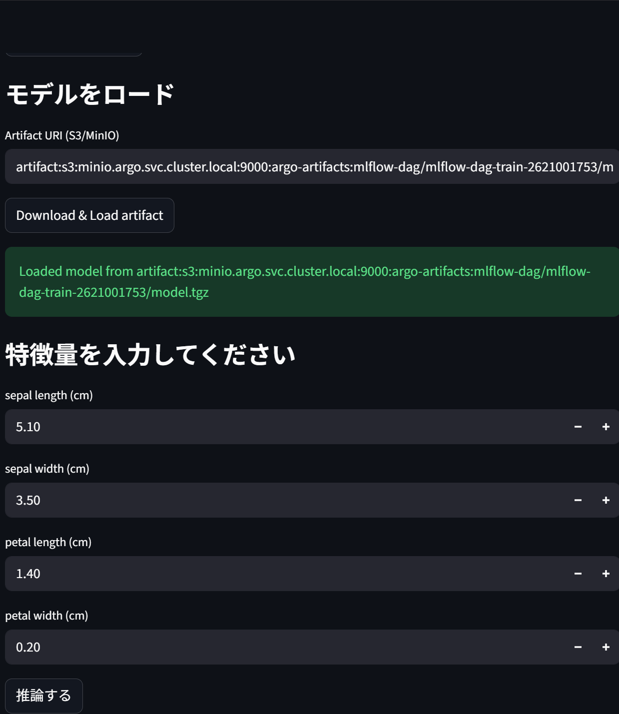
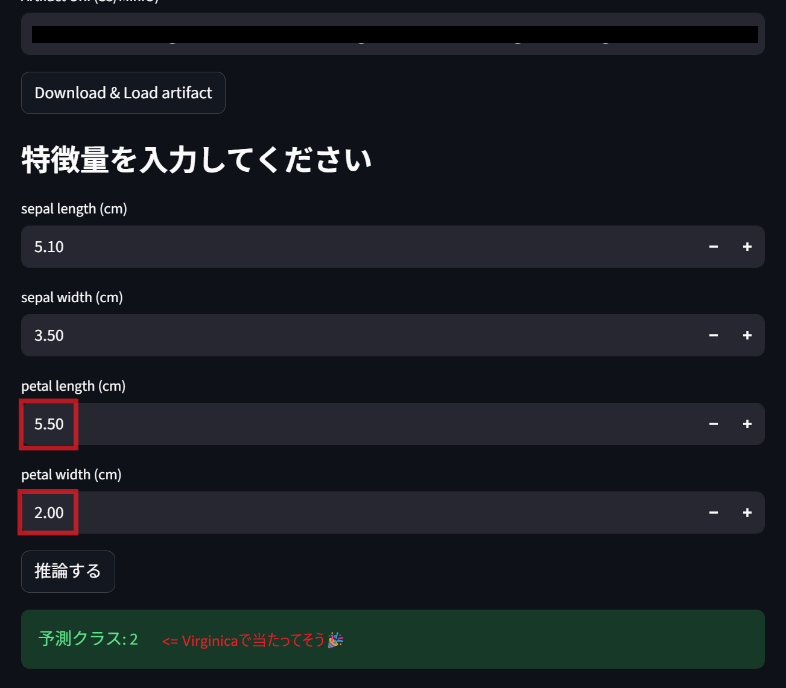

# Streamlit

Iris の 4 特徴量を入力して推論するダッシュボードです。Deployment は `mlflow` 名前空間、画面は http://streamlit.local です。

## 前提

- [MinIO と MLflow](02-mlflow.md) が済んでいること
- クラスター名 `agritech-mlops`
- `/etc/hosts` に `streamlit.local` があること（[クラスター手順](01-cluster.md)）

## 何をするか

[streamlit/app.py](../streamlit/app.py) にはモデルの読み込みが二つあります。

- **Load registry model**: `models:/argo-dag-demo/2` を `mlflow.pyfunc.load_model` で読む
- **Download & Load artifact**: MinIO の `model.tgz` を下ろして読む。初期値は `argo-artifacts` バケット内の DAG 成果物。アクセスキーの既定は `minio` / `minio123`

推論ボタンは、どちらかで `session_state` に載ったモデルを使います。

Deployment は `MLFLOW_TRACKING_URI` を渡していません。Registry ボタンを使うときは、Pod から MLflow へ届く次の値を Deployment に足してください。

```yaml
- name: MLFLOW_TRACKING_URI
  value: "http://mlflow-svc.mlflow.svc.cluster.local:5000"
- name: MLFLOW_S3_ENDPOINT_URL
  value: "http://minio.argo.svc.cluster.local:9000"
- name: AWS_ACCESS_KEY_ID
  value: "minio"
- name: AWS_SECRET_ACCESS_KEY
  value: "minio123"
```

artifact ボタンは、コード内の既定キーで MinIO に届きます。URI は MLflow の成果物パスに合わせて書き換えてください。

## 手順

```bash
docker build -t localhost:5001/streamlit-iris:latest -f streamlit/Dockerfile streamlit
kind load docker-image localhost:5001/streamlit-iris:latest --name agritech-mlops

kubectl apply -f streamlit/streamlit-deploy.yaml
kubectl apply -f streamlit/streamlit-svc.yaml
kubectl apply -f streamlit/streamlit-ingress.yaml
kubectl -n mlflow rollout status deployment/streamlit
```

画面や依存を直したあとは、同じ build と `kind load` のあと `kubectl -n mlflow rollout restart deployment/streamlit` します。

## 確認

http://streamlit.local を開き、モデルを読み込んでから「推論する」を押します。予測クラスが数字で出れば通っています。





```bash
kubectl -n mlflow get pods,svc,ingress -l app=streamlit
curl -I http://streamlit.local
```

`ImagePullBackOff` のときは [つまずき](pitfalls.md) のとおり、`kind load` のイメージ名を Deployment の `localhost:5001/streamlit-iris:latest` に合わせます。

## 関連ファイル

- [streamlit/app.py](../streamlit/app.py)
- [streamlit/s3_utils.py](../streamlit/s3_utils.py)
- [streamlit/Dockerfile](../streamlit/Dockerfile)
- [streamlit/streamlit-deploy.yaml](../streamlit/streamlit-deploy.yaml)
- [streamlit/streamlit-svc.yaml](../streamlit/streamlit-svc.yaml)
- [streamlit/streamlit-ingress.yaml](../streamlit/streamlit-ingress.yaml)
