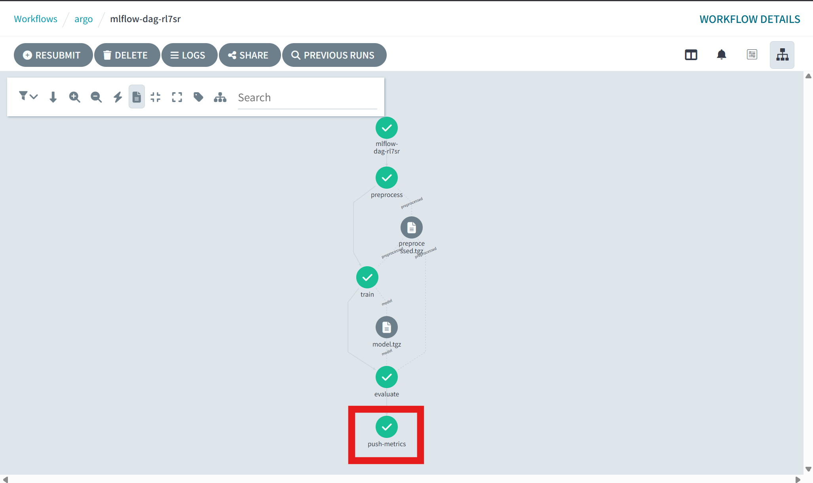
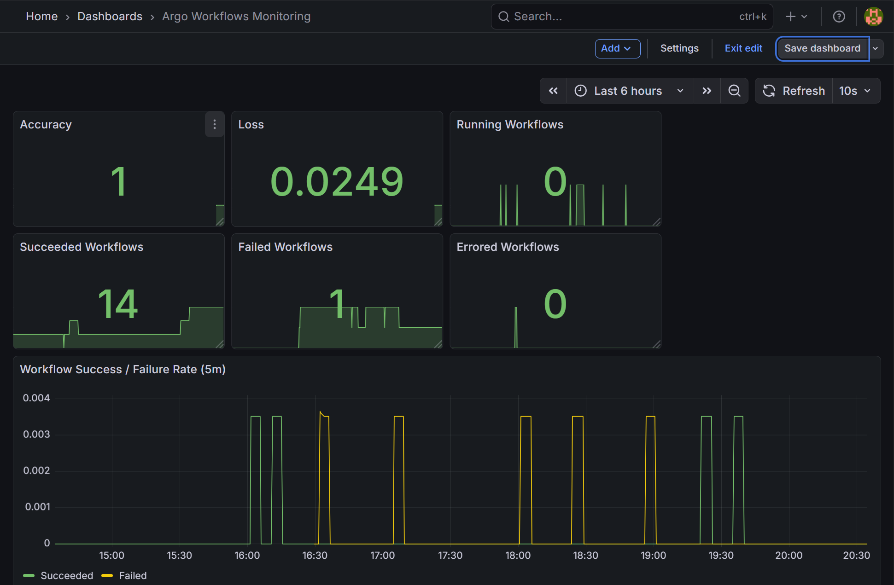
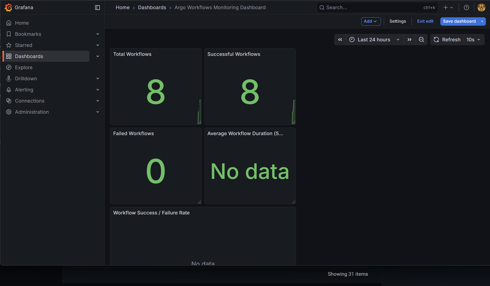

# Prometheus / Grafana

kube-prometheus-stack でメトリクスを集め、Argo の workflow-controller、MLflow exporter、学習 DAG が Pushgateway に送る accuracy / loss を見ます。

## 前提

- [Argo](03-argo.md) と [MLflow](02-mlflow.md) が動いていること
- Helm
- クラスター名 `agritech-mlops`

## 手順

### kube-prometheus-stack

```bash
helm repo add prometheus-community https://prometheus-community.github.io/helm-charts
helm repo update
helm install kube-prometheus-stack prometheus-community/kube-prometheus-stack \
  -n monitoring --create-namespace
kubectl -n monitoring get pods
```

Grafana の初期パスワードは Secret から取り出します。ユーザーは `admin` です。

```bash
kubectl get secret -n monitoring kube-prometheus-stack-grafana \
  -o jsonpath="{.data.admin-password}" | base64 -d ; echo

POD=$(kubectl -n monitoring get pod -l app.kubernetes.io/name=grafana,app.kubernetes.io/instance=kube-prometheus-stack -o name)
kubectl -n monitoring port-forward "$POD" 3000:3000
```

ブラウザは http://localhost:3000 です。

### Argo のメトリクス

[argo-artifact-config.yaml](../argo-artifact-config.yaml) の `metricsConfig` で controller の `/metrics`（9090）を有効にします。Argo 手順で未適用ならここで適用します。

```bash
kubectl apply -f argo-artifact-config.yaml
kubectl apply -f monitoring/workflow-controller-service.yaml
kubectl apply -f monitoring/argo-servicemonitor.yaml
kubectl -n argo rollout restart deployment/workflow-controller
```

ServiceMonitor は `monitoring` 名前空間にあり、ラベル `release: kube-prometheus-stack` を付けてあります。kube-prometheus-stack はこのラベルの ServiceMonitor を拾います。

### MLflow exporter

Deployment のイメージは `localhost:5001/mlflow-prometheus-exporter:local` です。ソースはこのリポジトリに同梱していないので、[canonical/mlflow-prometheus-exporter](https://github.com/canonical/mlflow-prometheus-exporter) をビルドして Kind に載せます。

```bash
git clone https://github.com/canonical/mlflow-prometheus-exporter.git /tmp/mlflow-prometheus-exporter
docker build -t localhost:5001/mlflow-prometheus-exporter:local /tmp/mlflow-prometheus-exporter
kind load docker-image localhost:5001/mlflow-prometheus-exporter:local --name agritech-mlops

kubectl apply -f monitoring/mlflow-exporter-deployment.yaml
kubectl apply -f monitoring/mlflow-exporter-service.yaml
kubectl apply -f monitoring/mlflow-exporter-servicemonitor.yaml
kubectl -n mlflow rollout status deployment/mlflow-exporter
```

### Pushgateway

DAG の `push-metrics` は次の URL に POST します。

`http://pushgateway-prometheus-pushgateway.monitoring.svc.cluster.local:9091/metrics/job/model_training`

Helm のリリース名を `pushgateway` にすると、この Service 名になります。`pushgateway.monitoring.svc` という短い名前は解決しません。

```bash
helm install pushgateway prometheus-community/prometheus-pushgateway -n monitoring
kubectl apply -f monitoring/pushgateway-servicemonitor.yaml
```

監視を入れたあと、DAG を再実行すると accuracy / loss が載ります。`push-metrics` まで緑になれば送信まで終わっています。



```bash
kubectl -n argo delete workflow mlflow-dag --ignore-not-found
kubectl -n argo create -f pipelines/dag/mlflow-dag-workflow.yaml
```

### Grafana の JSON

[monitoring/grafana/argo-workflows.json](../monitoring/grafana/argo-workflows.json) と [monitoring/grafana/mlflow-overview.json](../monitoring/grafana/mlflow-overview.json) は Grafana の Import から読み込めます。パネルの PromQL は例です。exporter や Argo が実際に出しているメトリクス名に合わせて書き換えてください。

## 確認

```bash
kubectl -n monitoring port-forward svc/kube-prometheus-stack-prometheus 9090:9090
```

http://127.0.0.1:9090/targets で `workflow-controller`、`mlflow-exporter`、`pushgateway` が up であれば scrape は通っています。

Grafana では workflow の成否と、Pushgateway 経由の accuracy / loss を同じダッシュボードに置けます。





Pushgateway 単体は次で確認できます。

```bash
kubectl -n monitoring port-forward svc/pushgateway-prometheus-pushgateway 9091:9091
echo "model_accuracy 0.95" | curl --data-binary @- http://localhost:9091/metrics/job/model_training
```

http://localhost:9091 の metrics に `model_accuracy` が出ます。

## 関連ファイル

- [monitoring/workflow-controller-service.yaml](../monitoring/workflow-controller-service.yaml)
- [monitoring/argo-servicemonitor.yaml](../monitoring/argo-servicemonitor.yaml)
- [monitoring/mlflow-exporter-deployment.yaml](../monitoring/mlflow-exporter-deployment.yaml)
- [monitoring/mlflow-exporter-service.yaml](../monitoring/mlflow-exporter-service.yaml)
- [monitoring/mlflow-exporter-servicemonitor.yaml](../monitoring/mlflow-exporter-servicemonitor.yaml)
- [monitoring/pushgateway-servicemonitor.yaml](../monitoring/pushgateway-servicemonitor.yaml)
- [pipelines/dag/mlflow-dag-workflow.yaml](../pipelines/dag/mlflow-dag-workflow.yaml)
